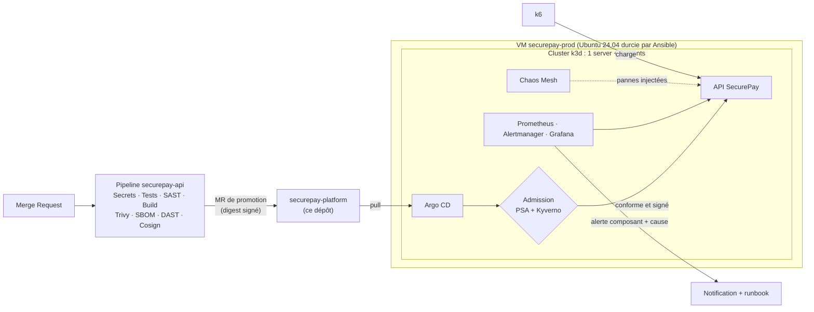

# SecurePay Solutions — Platform (Squelette de Départ)

> **Projet fil rouge :** Mise en œuvre d'une plateforme sécurisée et résiliente  
> **Établissement :** Sup de Vinci — Mastère DevOps (M2)  
> **Titre RNCP :** RNCP 40165 - Bloc 5 : *Piloter l'alignement stratégique entre architectures et DevSecOps*  
> **Dépôt applicatif associé :** [Momotoculteur/securepay-api](https://github.com/Momotoculteur/securepay-api)

Ce dépôt décrit **l'état désiré de la plateforme de production** de SecurePay : provisioning de la VM, cluster Kubernetes, applications Argo CD, politiques d'admission, supervision, expériences de chaos, tests de robustesse et documentation d'exploitation.

**Ce n'est pas une solution.** Il fournit ce qui ferait perdre du temps sans rien apprendre (bootstrap fonctionnel, pièges de compatibilité k3s déjà levés, modèles de documents) et marque d'un `TODO [Jx]` tout ce que vous devez concevoir. Comme pour `securepay-api`, les commentaires `[AUDIT ANOMALY]` signalent les défauts volontaires à corriger.

---

## 1. Contexte Métier

Un an après l'industrialisation de sa pipeline CI/CD, SecurePay migre son API de paiement vers une plateforme conteneurisée. Le comité de direction a gelé la mise en production après une série d'incidents :

| Incident | Ce qu'il révèle |
| :--- | :--- |
| **Black Friday** : deux heures d'indisponibilité sur saturation CPU | Aucun autoscaling, capacité jamais mesurée |
| **Perte d'un serveur** : l'unique instance de l'API tournait sur le nœud tombé | Point de défaillance unique, reprise manuelle |
| **Release défectueuse** restée 40 minutes en production | Aucun rollback automatique |
| **Diagnostic à l'aveugle** : une heure pour comprendre qu'un OOMKill causait les redémarrages | Alertes qui ne disent ni quel composant, ni pourquoi |
| **Audit PSSI défavorable** | SSH root par mot de passe, conteneurs root, aucune politique d'admission, secrets en clair dans les manifests |

Le gel ne sera levé qu'au vu de **preuves** : une plateforme sécurisée par construction, durcie selon les standards de l'industrie, et dont la résistance aux pannes est démontrée.

---

## 2. Architecture Cible



---

## 3. Prérequis du Poste

- 16 Go de RAM recommandés (8 Go minimum avec `VM_MEMORY=6G`, sans stack de logs), 4 cœurs, 60 Go de disque libre, virtualisation activée
- [Multipass](https://canonical.com/multipass), `kubectl`, `helm`, `k6`, `git`, `make`, Docker (pour `make lint` et le runner GitLab self-hosted)
- Ansible pour le jalon J2 (sous Windows : depuis WSL2)
- Une paire de clés SSH (`~/.ssh/id_ed25519.pub` par défaut, sinon `SSH_PUBLIC_KEY_FILE=...`)

Les outils installés **dans la VM** (Docker, k3d, kubectl, helm) sont épinglés dans [`bootstrap/versions.env`](bootstrap/versions.env) et vérifiés par somme de contrôle.

---

## 4. Démarrage Rapide

1. **Importer** ce dépôt dans le groupe GitLab du trinôme, à côté de `securepay-api`, et protéger `main` (merge par MR uniquement, pipeline au vert obligatoire).
2. **Remplacer le placeholder** `<groupe>` par votre groupe GitLab dans `apps/` et dans `charts/securepay-api/values.yaml`, puis committer par MR.
3. **Donner à Argo CD l'accès en lecture** au dépôt : créer un deploy token `read_repository`, puis :

    ```bash
    cp bootstrap/repo-credentials.env.example bootstrap/repo-credentials.env   # ignoré par Git
    # renseigner l'URL du dépôt et le deploy token
    ```

4. **Créer la VM puis la plateforme :**

    ```bash
    make vm          # VM Multipass securepay-prod (Ubuntu 24.04, 4 vCPU, 8 Go, 40 Go)
    make bootstrap   # Docker, k3d, cluster, Argo CD, application racine
    make kubeconfig  # kubeconfig pour piloter le cluster depuis le poste
    make hosts       # lignes à ajouter à /etc/hosts
    make argocd-password
    ```

5. Ouvrir `http://argocd.securepay.local` (utilisateur `admin`) : l'application `securepay-api` se synchronise depuis Git.

Toutes les cibles sont idempotentes : `make bootstrap` se rejoue sans effet de bord. `make help` liste les commandes.

---

## 5. Structure du Dépôt

```text
securepay-platform/
├── Makefile                   # Commandes du poste (vm, bootstrap, kubeconfig, lint...)
├── .gitlab-ci.yml             # Validation de l'état désiré (yamllint, helm, kubeconform, ansible-lint, kyverno)
├── bootstrap/                 # cloud-init, versions épinglées, scripts d'installation (exécutés dans la VM)
├── apps/                      # Argo CD : application racine, applications actives (children/) et prêtes (catalog/)
├── charts/securepay-api/      # Chart Helm de l'API, volontairement non durci
├── policies/                  # Politiques Kyverno (ValidatingPolicy) et leurs tests CLI
├── observability/             # Valeurs kube-prometheus-stack (k3s), PrometheusRules, dashboards
├── chaos/                     # Valeurs Chaos Mesh (k3s) et expériences, jamais synchronisées automatiquement
├── tests/robustness/          # Scénarios k6 alignés sur les SLO
├── ansible/                   # Durcissement de la VM (CIS / ANSSI) et audit Lynis
└── docs/                      # Registre des risques, conformité, résilience, runbooks, ADR, postmortems, audit, preuves
```

---

## 6. Jalons

| Fin de | Jalon | Où travailler |
| :---: | :--- | :--- |
| **J1** | Usine logicielle opérationnelle : pipeline au vert, image signée promue par MR et synchronisée par Argo CD | `docs/risques.md`, pipeline de `securepay-api`, `charts/`, `apps/` |
| **J2** | Plateforme durcie : VM et cluster, audits avant/après, refus d'admission prouvés | `ansible/`, `policies/`, `charts/`, `apps/catalog/` (sealed-secrets, kyverno), `docs/conformite.md` |
| **J3** | Robustesse mesurée : SLO alertés, campagne de stress et de surcharge, point de rupture | `observability/`, `tests/robustness/`, `docs/resilience.md` |
| **J4** | Résilience démontrée : GameDay, rollback automatique, alertes qualifiant composant et cause, runbooks | `chaos/`, `observability/rules/`, `apps/catalog/` (argo-rollouts), `docs/runbooks/`, `docs/postmortems/` |
| **J5** | Audit croisé, remédiation des constats, tag `v1.0.0` | `docs/audit/`, `docs/preuves/` |

Pour retrouver le travail restant : `grep -rn "TODO \[J" .`

---

## 7. Règles du Jeu

- **Tout as code, zéro ClickOps** : aucune modification manuelle du cluster ou de la VM qui ne soit pas versionnée. Un `kubectl edit` en production est une dérive, pas une correction.
- **Toute mise en production passe par une Merge Request** sur ce dépôt : c'est le registre d'audit du contrôle des changements.
- **Aucun secret en clair dans Git**, y compris dans les valeurs Helm. Le seul secret créé hors de Git est l'accès d'Argo CD au dépôt (`bootstrap/repo-credentials.env`), à remplacer au J2.
- **Les expériences de chaos ne sont jamais synchronisées automatiquement** : elles se déclenchent à la main, sous charge, avec une hypothèse et une condition d'arrêt.
- **Prouver plutôt qu'affirmer** : chaque contrôle et chaque test de résistance laisse une preuve horodatée dans `docs/preuves/`.

---

## 8. Versions Épinglées

| Composant | Version | Où |
| :--- | :--- | :--- |
| k3d / k3s | v5.9.0 / v1.35.5+k3s1 | `bootstrap/versions.env` |
| kubectl / helm (dans la VM) | v1.35.10 / v4.3.1 | `bootstrap/versions.env` |
| Argo CD (chart) | 10.11.6 (Argo CD v3.5.6) | `bootstrap/versions.env` |
| Kyverno (chart) | 3.9.2 (Kyverno v1.19.2) | `apps/catalog/kyverno.yaml` |
| kube-prometheus-stack | 92.17.0 | `apps/catalog/monitoring.yaml` |
| Chaos Mesh | 2.8.7 | `apps/catalog/chaos-mesh.yaml` |
| Sealed Secrets (chart) | 2.22.0 (contrôleur v0.41.2) | `apps/catalog/sealed-secrets.yaml` |
| Argo Rollouts (chart) | 2.43.8 (Argo Rollouts v1.10.1) | `apps/catalog/argo-rollouts.yaml` |

---

## 9. Ressources

- Dépôt applicatif : [Momotoculteur/securepay-api](https://github.com/Momotoculteur/securepay-api)
- Cours : [Durcir une plateforme : supply chain, hardening as code & Kubernetes](https://bastienmaurice.fr/slides/devsecops/platform-hardening/platform-hardening/)
- Cours : [Resilience Engineering : SLO, robustness testing, chaos & auto-remédiation](https://bastienmaurice.fr/slides/sre/resilience-engineering/resilience-engineering/)
